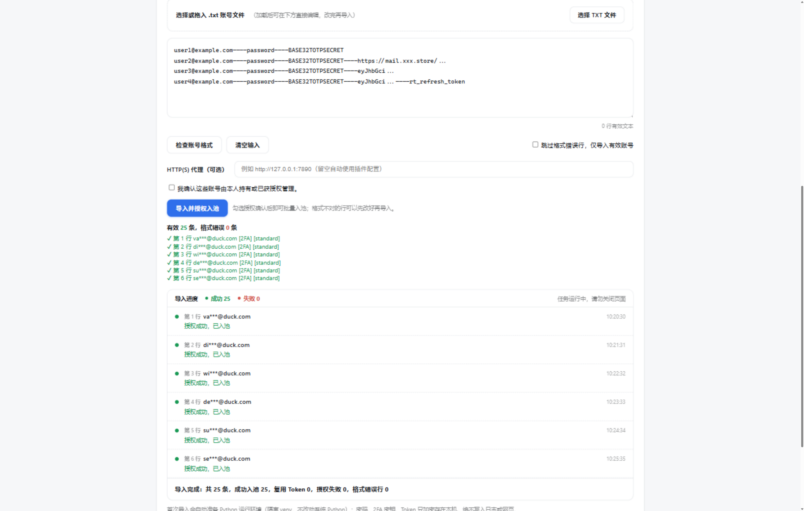
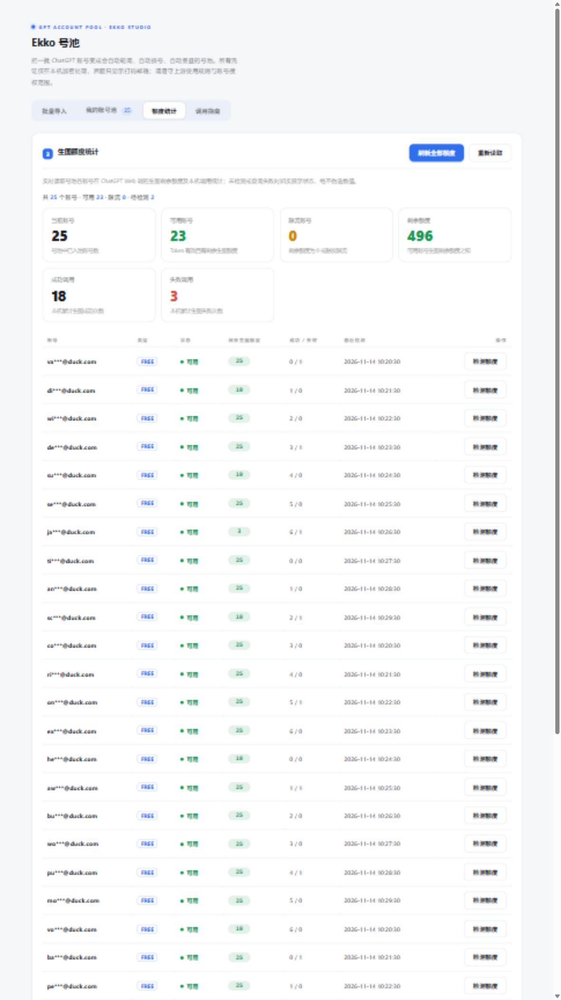
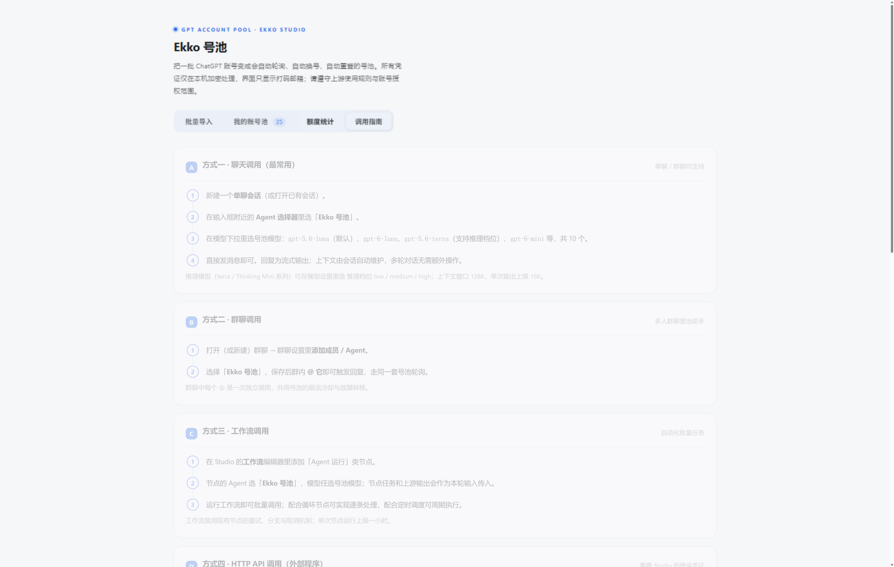

<div align="center">

# Ekko 号池

**Ekko Studio 插件 · 把一批 ChatGPT 免费普号变成自动轮询的号池**

自动换号 · 自动重登 · 流式聊天 · AI 生图 · 额度统计 · 跨 Agent 调用

[](https://github.com/EKKOLearnAI/ekko-studio)
[](https://github.com/qiyuechen0929/ekko-gptfree-pool/releases)
[](LICENSE)

</div>

---

## 目录

- [简介](#简介)
- [功能特性](#功能特性)
- [安装](#安装)
- [网络要求（务必先读）](#网络要求务必先读)
- [快速上手](#快速上手)
- [支持的账号格式](#支持的账号格式)
- [界面与页面详解](#界面与页面详解)
- [五种调用方式](#五种调用方式)
- [常见问题](#常见问题)
- [数据安全](#数据安全)
- [开发与构建](#开发与构建)
- [免责声明](#免责声明)
- [许可协议](#许可协议)

## 简介

Ekko 号池把**一批普通的 ChatGPT 账号**汇成一个统一的号池：导入后插件在后台自动完成 OAuth + TOTP 登录换取 Token，日常使用时按需轮询账号、自动冷却被限流的账号、Token 过期自动重登。对使用者来说就是一个普通的模型来源——聊天、生图、API 调用都由号池自动在后台换号，不需要人工干预。

所有凭证仅保存在本机（AES-256-GCM 加密），界面只显示打码邮箱。

## 功能特性

| 特性 | 说明 |
| --- | --- |
| 批量导入 | TXT 文件选择 / 拖拽 / 粘贴，四种账号格式自动识别，错误行可直接在页面修正 |
| 全自动登录 | 后台 HTTP OAuth + TOTP 换取 Token，不弹网页、不开浏览器；首次运行自动准备隔离 Python 环境 |
| 多账号轮询 | Token 过期自动重登、429 自动冷却换号、单号失败自动切换下一个 |
| 流式聊天 | 号池 Agent 提供 10 个文本模型（GPT-6 / 5.6 系列），128K 上下文，支持推理档位 |
| AI 生图 | `gpt-image-2` 及 2.6 全系列（含 GIF 输出），`/pool:image` 命令一键生图 |
| 跨 Agent 调用 | 注册为 Studio 共享 MCP 工具，Pi / Hermes / Coding Agent 均可直接调用 |
| 额度统计 | 实时读取官方生图额度 + 本地调用账本 + 最近 100 条调用记录（持久化） |
| 本机安全 | 凭证 AES-256-GCM 加密存储，日志与界面只显示打码邮箱 |

## 安装

1. 打开 **Ekko Studio → 插件中心**
2. 在安装入口填入仓库地址：

   ```
   https://github.com/qiyuechen0929/ekko-gptfree-pool
   ```

3. 启用插件，左侧导航出现 **GPT号池** 入口

> 开发者模式：`ekko-studio web plugins link <本项目路径>`，在 插件中心 → 开发插件 启用后支持源码监听与自动重载。

## 网络要求（务必先读）

插件的登录与调用发生在**后台进程**，直接访问 ChatGPT 的授权域名——浏览器代理、"系统代理"对它通常**不生效**。如果所在网络无法直连 ChatGPT，导入时会看到 `authorize_failed_403` 或 `Failed to connect to auth`。

**两种解决方案（任选其一）：**

<details open>
<summary><b>方案一：开启 TUN 模式（推荐）</b></summary>

TUN（虚拟网卡）将整机所有流量送入代理，后台进程同样生效：

| 客户端 | 操作 |
| --- | --- |
| Clash Verge / Clash for Windows | 设置 → 打开 **TUN 模式**，按提示授权安装服务 |
| v2rayN | 设置中启用 **TUN 模式** |
| Sing-box | 添加并启用 **TUN** 入站 |

开启后回到插件页直接导入，无需额外配置。

</details>

<details>
<summary><b>方案二：手动填写 HTTP(S) 代理</b></summary>

在插件页底部的 **HTTP(S) 代理** 输入框填入无认证代理地址：

```
http://127.0.0.1:7890
```

端口以你的代理软件为准（Clash 默认 7890，v2rayN 默认 10809）。也可以在 **插件中心 → 本插件 → 配置** 中长期保存，登录与模型调用共用。

</details>

## 快速上手

**① 买号** — 到 [priceai.cc](https://priceai.cc/) 购买 GPT 普号（约三毛钱 10 个，自带生图额度），在订单页复制提取文本。

**② 导入** — 打开插件「批量导入」页：粘贴或选择 TXT → 点「检查账号格式」预览 → 勾选授权确认 → 点「导入并授权入池」。进度逐行实时显示，失败原因直接标出。

**③ 开用** — 新建聊天，Agent 选「**Ekko 号池**」，模型选 `gpt-5.6-luna` 即可对话；生图直接对任何 Agent 说"用号池生成一张…"，或敲 `/pool:image <描述>`。

## 支持的账号格式

每行一条，分隔符兼容 `----` 与 `---`：

| 格式 | 示例 | 说明 |
| --- | --- | --- |
| 标准三字段 | `邮箱----密码----2FA密钥` | 最常用 |
| 带邮箱链接 | `邮箱----密码----2FA密钥----https://mail.xxx.store/...` | 链接仅作标记，不会被访问 |
| 带 Token | `邮箱----密码----2FA密钥----eyJhbGci...` | Token 有效则复用，过期自动重登 |
| 五字段 RefreshToken | `...----eyJhbGci...----rt_...` | 兼容卡密导出格式 |
| 无 2FA | `邮箱----密码` | 可用，平台额外验证时可能失败 |

单批最多 100 条，可多次追加，累计支持 1000 个账号轮询。

## 界面与页面详解

### 批量导入

三步指引、格式规范面板、TXT 选择/拖拽、格式检查预览、授权确认、实时导入进度（行号 + 打码邮箱 + 中文状态 + 成功/失败统计）。




### 我的账号池

账号清单（打码邮箱、2FA 标记、Token 状态 🟢有效 / 🟡待重登 / 🔴过期）、单账号检测/移除、全部重新登录。


### 额度统计

六项核心指标卡、逐账号官方实时生图额度、成功/失败次数、最近 100 条调用记录（生图 / 对话 / 额度刷新，持久化保存）。「刷新全部额度」4 路并发，25 个账号约半分钟。



### 调用指南

五种调用方式的完整图文教程与常见问题排查，内置在插件页面中，离线可查。



## 五种调用方式

### 1. 聊天调用（最常用）

新建单聊 → Agent 选择器选「**Ekko 号池**」→ 模型选 `gpt-5.6-luna`（默认）/ `gpt-6` / `gpt-5.6-terra` 等共 10 个 → 直接对话。推理模型支持 low / medium / high 档位；上下文 128K，单次输出上限 16K。

### 2. 群聊调用

群聊设置 → 添加成员 → 选「Ekko 号池」，群内 @ 它触发回复，与单聊共用同一套轮询与限流冷却。

### 3. 工作流调用

工作流编辑器中添加「Agent 运行」节点，Agent 选「Ekko 号池」；节点任务与上游输出自动作为输入。配合循环节点逐条处理、配合定时调度周期执行。

### 4. HTTP API 调用（外部程序）

```bash
# 创建绑定号池 Agent 的会话
curl -X POST "http://<地址>/api/studio/sessions" \
  -H "Authorization: Bearer <TOKEN>" -H "Content-Type: application/json" \
  -d '{"title":"号池测试","agent":"plugin:pool/pool"}'

# 发送输入
curl -X POST "http://<地址>/api/studio/sessions/<会话ID>/run" \
  -H "Authorization: Bearer <TOKEN>" -H "Content-Type: application/json" \
  -d '{"input":"你好，介绍一下你自己"}'

# 读取回复
curl "http://<地址>/api/studio/sessions/<会话ID>/messages" \
  -H "Authorization: Bearer <TOKEN>"
```

### 5. 跨 Agent 工具调用（Pi / Hermes / Coding Agent）

插件启用后自动注册到 Studio 共享 MCP，任何 Agent 可直接调用：

| 工具 | 用途 | 参数 |
| --- | --- | --- |
| `pool__pool_status` | 查询号池账号数 / 可用数 | 无 |
| `pool__pool_chat` | 号池完成一次单轮对话 | `message`（必填）、`model`（可选） |
| `pool__generate_image` | 生图，返回本地图片路径 | `prompt`（必填）、`size` / `model` / `background`（可选） |

直接用自然语言即可触发：

> 用号池生成一只戴墨镜的橘猫

或使用聊天命令：`/pool:image 极简风格的雪山日出图标`

生成的图片保存在插件数据目录 `images/` 下，AI 会把文件路径回复给你。

> 工具未出现在 Agent 工具列表？刷新 MCP 管理页，或让 Agent 新开一轮运行（工具目录在轮次开始时加载）。

## 常见问题

<details>
<summary><b>导入报 authorize_failed_403 / Failed to connect to auth</b></summary>

出口 IP 被 Cloudflare 拦截或无法连通授权域名。开启 TUN 模式，或填写 HTTP(S) 代理后重试；部分代理节点被风控盯得紧，换个节点通常即可解决。

</details>

<details>
<summary><b>模型列表为空 / 选不到号池模型</b></summary>

号池中没有 Token 有效的账号。先导入账号，或在「我的账号池」对失败账号点「检测/刷新」。

</details>

<details>
<summary><b>对话返回 429</b></summary>

免费账号有上游速率限制。号池会自动冷却触发限流的账号并切换下一个；若全部账号均被限流，导入更多账号或稍后再试。

</details>

<details>
<summary><b>对话中途 Token 失效</b></summary>

号池会自动重新登录该账号并重试，无需手动处理；长期失败时在「我的账号池」点「检测/刷新」。

</details>

<details>
<summary><b>导入进度中断 / Studio 重启后进度消失</b></summary>

导入进度保存在内存中，Studio 重载会丢失；已入池账号不受影响。重新导入即可，重复账号自动去重。

</details>

<details>
<summary><b>如何获得更高质量的回答</b></summary>

选择 `gpt-5.6-terra` 或 Thinking Mini 系列，将推理档位调至 high；代价是响应更慢、更耗账号额度。

</details>

## 数据安全

- 密码、2FA 密钥、Token 仅以 **AES-256-GCM** 加密存储于本机插件数据目录
- 界面与日志仅显示打码邮箱（如 `va***@duck.com`）
- 凭证不写入配置文件、不上传、不以明文进入日志

## 开发与构建

```bash
# 登记为开发插件（源码监听、自动重载）
ekko-studio web plugins link D:/gptfree-pool-ekko

# 单元测试（号池核心模块）
npm test

# 语法检查
npm run check
```

项目结构：

```
plugin.json            # Ekko Studio 插件清单
ekko-server.mjs        # 后端：Agent 运行时、RPC、MCP 工具、Python worker 管理
ekko-client.mjs        # 前端：管理页（导入 / 账号池 / 额度统计 / 调用指南）
index.mjs              # 号池核心公共入口
lib/                   # 号池核心：轮询、加密存储、OAuth 适配、生图、统计
python/                # 登录与生图 worker（PKCE / turnstile / PoW）
test/                  # 核心模块单元测试
docs/images/           # README 截图
```

## 免责声明

本项目为个人自用工具，与 OpenAI 无任何关联。插件仅保存**你本人有权使用**的账号凭证，请遵守账号服务条款。因使用不当、批量采购账号或违反上游条款导致的封号、限流等后果由使用者自行承担。切勿将真实凭证 TXT、加密号池文件提交至任何仓库或分享给他人（本仓库 `.gitignore` 已排除相关文件）。

## 许可协议

[MIT](LICENSE)
