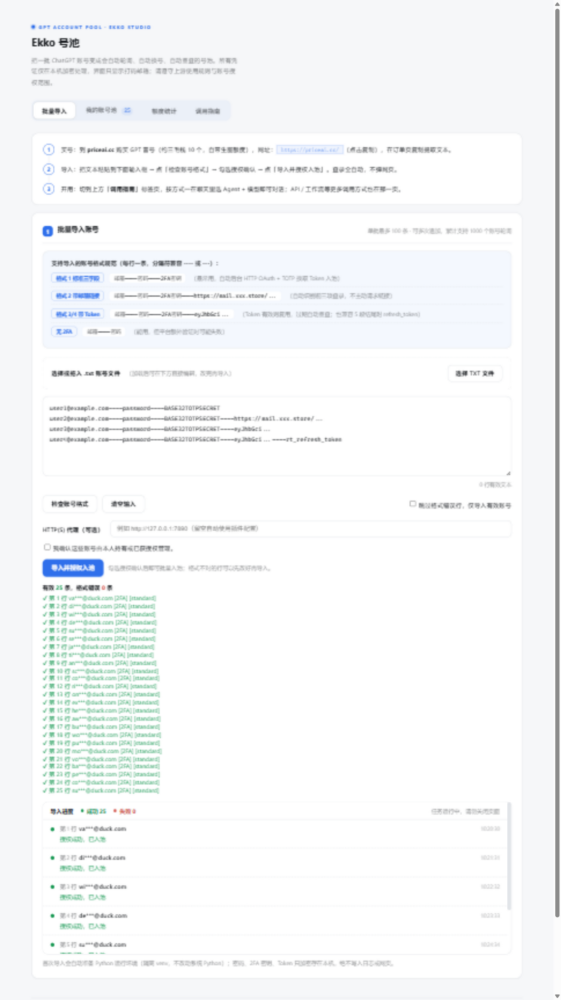
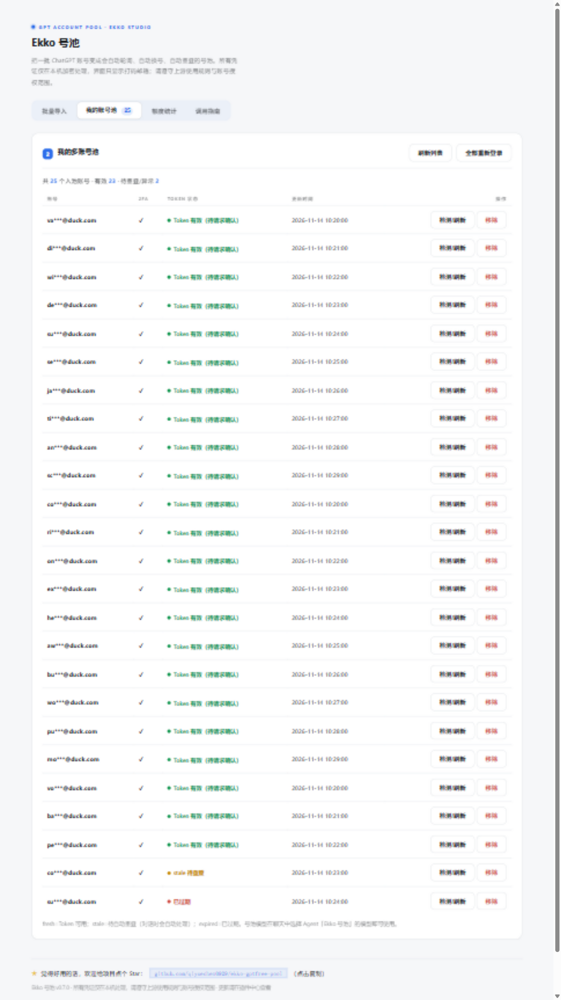

# Ekko 号池

> Ekko Studio 插件：把一批 ChatGPT 免费普号，变成一个**自动轮询、自动换号、自动重登**的号池。聊天、生图、额度统计、跨 Agent 工具调用，全都用它。

  

## ✨ 功能一览

- **批量导入**：选择 TXT 或直接粘贴，每行一个账号，格式错误行在页面里直接改
- **全自动登录**：后台 HTTP OAuth + TOTP 换取 Token 入池，不弹网页、不开浏览器
- **多账号真轮询**：Token 过期自动重登、429 自动冷却换号、单号挂了自动切下一个
- **生图**：`gpt-image-2` / `2.6` 全系列，2.6 系列支持 GIF
- **跨 Agent 调用**：号池注册为共享 MCP 工具，Pi / Hermes / Coding Agent 都能调用
- **额度看得见**：生图剩余额度实时读取官方接口，配合本地调用账本，未检测就显示"待检测"，绝不编造
- **数据不出本机**：凭证 AES-256-GCM 加密保存，界面只显示打码邮箱

## 🖼 界面预览

**批量导入**（分步指引 + 四种格式规范 + TXT 选择/拖入 + 实时进度）：



**我的账号池**（每个账号的 Token 状态一目了然）：



**额度统计**（官方实时额度 + 本地调用账本 + 最近调用记录）：


**调用指南**（四种调用方式 + 常见问题，都在插件页面里）：


## 📦 安装

1. 打开 Ekko Studio → **插件中心**
2. 在安装入口填入本仓库地址：`https://github.com/qiyuechen0929/ekko-gptfree-pool`
3. 启用插件，左侧导航出现 **GPT号池** 入口

> 开发者模式：`ekko-studio web plugins link <本项目路径>`，然后在 插件中心 → 开发插件 里启用，源码改动自动重载。

## ⚠️ 网络要求（重要，先看这个！）

插件的登录与调用是在**后台进程**里直接访问 ChatGPT 的，**"系统代理"对它通常无效**。如果你所在网络无法直连 ChatGPT，导入会报 `authorize_failed_403` 或 `Failed to connect to auth`。

**两种解决方案（任选其一）：**

### 方案一：开 TUN 模式（推荐，最省事）

TUN（虚拟网卡）会把整台机器的所有流量强制送进代理，后台进程也不例外：

- **Clash Verge / Clash for Windows**：设置 → 打开 **TUN 模式**（虚拟网卡），按提示授权安装服务
- **v2rayN**：设置里启用 **TUN 模式**
- **Sing-box**：开启 **TUN** 入站

开启后回到插件页直接导入即可，无需填代理。

### 方案二：手动填 HTTP(S) 代理

不开 TUN 也行：在插件页底部的 **HTTP(S) 代理**输入框填一个能访问 ChatGPT 的代理，例如：

```
http://127.0.0.1:7890
```

（端口看你自己的代理软件；Clash 默认 7890，v2rayN 默认 10809，注意填 http:// 开头的无认证地址）

也可以在 **插件中心 → 本插件 → 配置** 里长期保存代理，登录与模型调用共用。

## 🚀 三步开用

1. **买号**：到 [priceai.cc](https://priceai.cc/) 购买 GPT 普号（约三毛钱 10 个，自带生图额度），在订单页复制提取文本
2. **导入**：粘贴到「批量导入」页 → 点「检查账号格式」→ 勾选授权确认 → 点「导入并授权入池」，进度逐行显示
3. **开用**：回聊天，Agent 选「Ekko 号池」，模型选 `gpt-5.6-luna` 等即可对话；生图直接说或敲 `/pool:image`

## 📋 支持的账号格式

每行一条，分隔符兼容 `----` 与 `---`：

| 格式 | 示例 | 说明 |
| --- | --- | --- |
| 格式 1 标准三字段 | `邮箱----密码----2FA密钥` | 最常用，自动后台 OAuth + TOTP 入池 |
| 格式 2 带邮箱链接 | `邮箱----密码----2FA密钥----https://mail.xxx.store/...` | 自动识别前三项登录，不会访问链接 |
| 格式 3/4 带 Token | `邮箱----密码----2FA密钥----eyJhbGci...` | Token 有效则复用，过期自动重登 |
| 五字段 RefreshToken | `...----eyJhbGci...----rt_...` | 兼容卡密导出格式 |
| 无 2FA | `邮箱----密码` | 能用，但平台额外验证时可能失败 |

单批最多 100 条，可多次追加，累计支持 1000 个账号轮询。

## 🖥 页面功能详解

### 批量导入

- 顶部三步指引（买号 → 导入 → 开用）
- 格式规范面板：四种格式对照示例，小白照抄即可
- 「选择 TXT 文件」按钮 + 拖拽导入，加载后可直接编辑修正
- 「检查账号格式」逐行预览有效/错误/重复
- 可选 HTTP(S) 代理、跳过格式错误行、授权确认勾选
- 导入进度实时列表：行号 + 打码邮箱 + 中文状态（正在授权 / 已入池 / 失败原因），顶部悬浮成功/失败/处理中计数

### 我的账号池

- 汇总：`共 N 个 · 有效 N · 待重登/异常 N`
- 每行：打码邮箱、2FA 标记、Token 状态（🟢有效 / 🟡待重登 / 🔴过期）、更新时间
- 单账号「检测/刷新」「移除」，或「全部重新登录」

### 额度统计

- 六张大数字卡：当前账号 / 可用账号 / 限流账号 / 剩余额度 / 成功调用 / 失败调用
- 明细表：官方实时生图额度（绿色胶囊）、成功/失败次数、最近检测时间
- **最近调用记录**：生图 / 对话 / 额度刷新最近 100 条，持久化保存
- 「刷新全部额度」4 路并发检测，25 个账号约半分钟

### 调用指南

四种调用方式的完整图文教程 + 常见问题排查，都内置在插件页面里。

## 🔌 五种调用方式

### 方式一：聊天调用（最常用）

新建单聊 → Agent 选「**Ekko 号池**」→ 模型选 `gpt-5.6-luna`（默认）/ `gpt-6` / `gpt-5.6-terra` 等共 10 个 → 直接对话。推理模型支持 low / medium / high 推理档位；上下文 128K，单次输出 16K。

### 方式二：群聊调用

群聊设置里添加成员选「Ekko 号池」，群内 @ 它即可触发，走同一套轮询。

### 方式三：工作流调用

工作流编辑器添加 Agent 运行节点，Agent 选「Ekko 号池」，节点任务和上游输出自动作为输入；配合循环/调度可批量自动化。

### 方式四：HTTP API 调用（外部程序）

```bash
# 1. 创建绑定号池 Agent 的会话
curl -X POST "http://<地址>/api/studio/sessions" \
  -H "Authorization: Bearer <TOKEN>" -H "Content-Type: application/json" \
  -d '{"title":"号池测试","agent":"plugin:pool/pool"}'

# 2. 发送输入
curl -X POST "http://<地址>/api/studio/sessions/<会话ID>/run" \
  -H "Authorization: Bearer <TOKEN>" -H "Content-Type: application/json" \
  -d '{"input":"你好，介绍一下你自己"}'

# 3. 读取回复
curl "http://<地址>/api/studio/sessions/<会话ID>/messages" -H "Authorization: Bearer <TOKEN>"
```

### 方式五：跨 Agent 工具调用（Pi / Hermes / Coding Agent）

插件启用后，以下工具自动注册到 Studio 共享 MCP，**任何 Agent 都能调用**：

| 工具 | 用途 |
| --- | --- |
| `pool__pool_status` | 查询号池账号数 / 可用数 |
| `pool__pool_chat` | 用号池完成一次单轮对话（参数：`message` 必填、`model` 可选） |
| `pool__generate_image` | 生图并返回本地图片路径（参数：`prompt` 必填、`size` / `model` / `background` 可选） |

直接说人话即可触发，例如在 Pi 里：

> 用号池生成一只戴墨镜的橘猫

或敲命令：`/pool:image 极简风格的雪山日出图标`

图片保存在插件数据目录的 `images/` 文件夹，AI 会把路径回复给你。

> 工具列表没出现？刷新 MCP 管理页，或让 Agent 新开一轮运行。

## ❓ 常见问题

**导入报 `authorize_failed_403`？**
出口 IP 被 Cloudflare 拦截。开 TUN 模式，或在导入页填 HTTP(S) 代理后重试；部分节点被盯得紧，换个节点往往就好了。

**模型列表是空的？**
号池没有可用账号（或全部 Token 过期）。先导入账号，或对失败账号点「检测/刷新」。

**对话报 429？**
免费号有速率限制，号池会自动冷却并切换下一个账号；全部被限流时导入更多账号或稍后再试。

**对话中途 Token 失效？**
号池会自动重新登录该账号并重试，无需手动处理。

**导入进度中断了？**
导入进度保存在内存里，Studio 重载会丢失；已入池账号不受影响，重新导入即可（重复账号会自动去重）。

**想要更聪明的回答？**
选 `gpt-5.6-terra` 或 Thinking Mini 系列，推理档位调 high；代价是更慢、更耗额度。

## 🔒 数据安全

- 密码、2FA 密钥、Token 只做 **AES-256-GCM 加密**存储在本机插件数据目录
- 界面与日志只显示打码邮箱（`va***@duck.com`）
- 不写入配置、不上传、不进日志明文

## 🛠 开发

```bash
ekko-studio web plugins link D:/gptfree-pool-ekko   # 登记开发插件
npm test                                            # lib 单元测试
npm run check                                       # 语法检查
```

结构：

```
plugin.json / ekko-server.mjs / ekko-client.mjs    # Ekko Studio 适配层
lib/  python/  test/                               # 号池核心模块（OAuth worker / 轮询 / 加密存储 / 生图）
docs/images/                                       # README 截图
```

## ⚖️ 免责声明

本项目为个人自用工具，与 OpenAI 无任何关联。插件只保存**你本人有权使用**的账号凭证，请遵守账号服务条款；因使用不当、批量采购账号或违反上游条款导致的封号、限流等后果由使用者自行承担。切勿把真实凭证 TXT、加密号池文件提交到任何仓库（本仓库 `.gitignore` 已排除）。

## 📄 License

[MIT](LICENSE)
